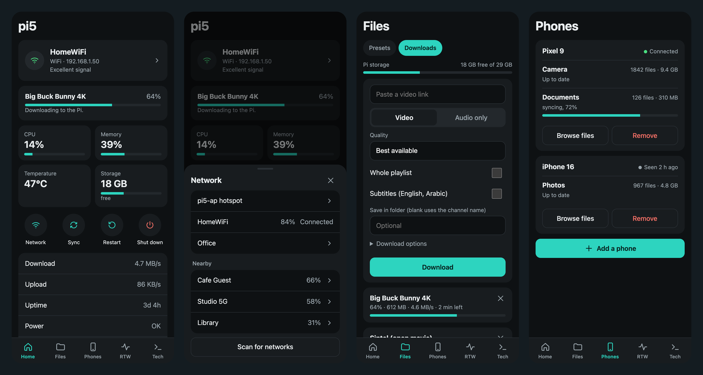
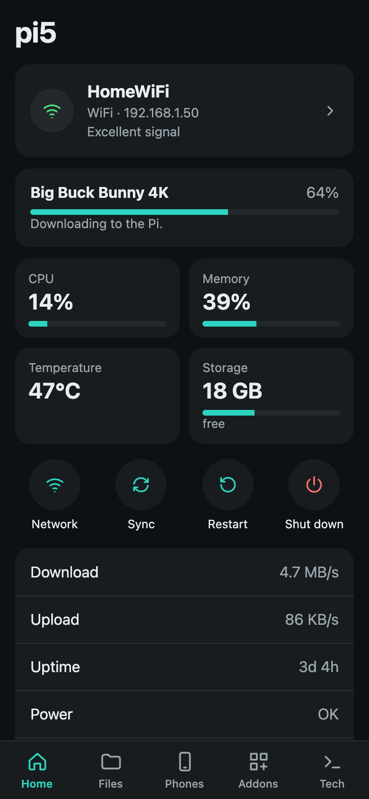
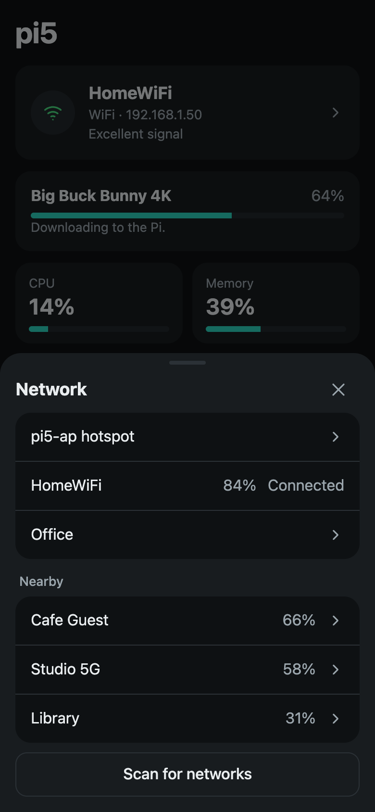
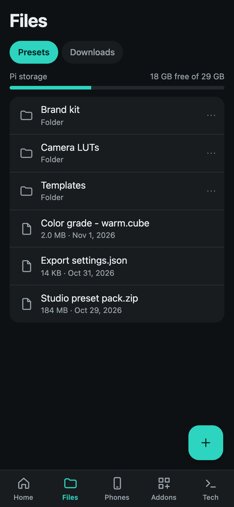
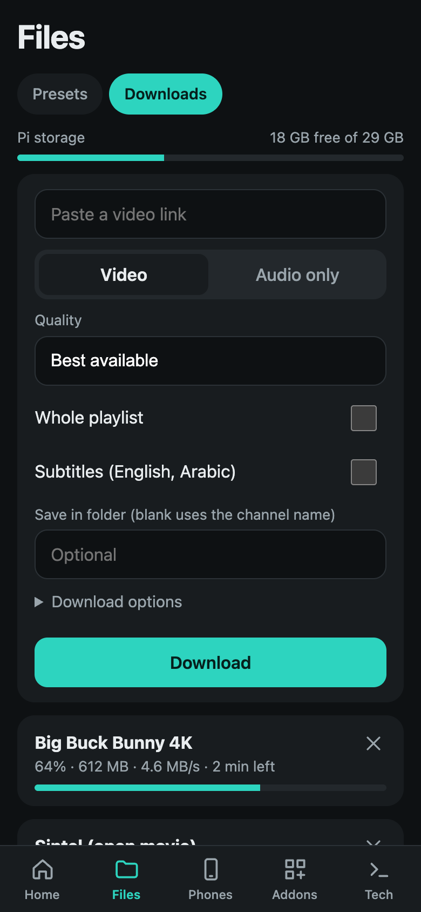
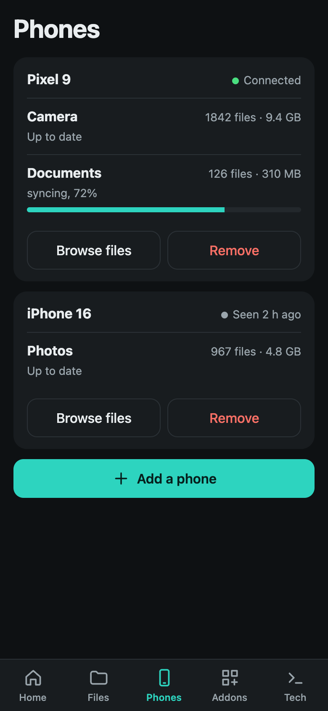
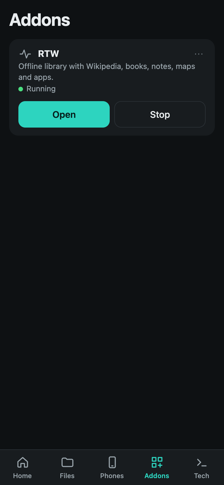
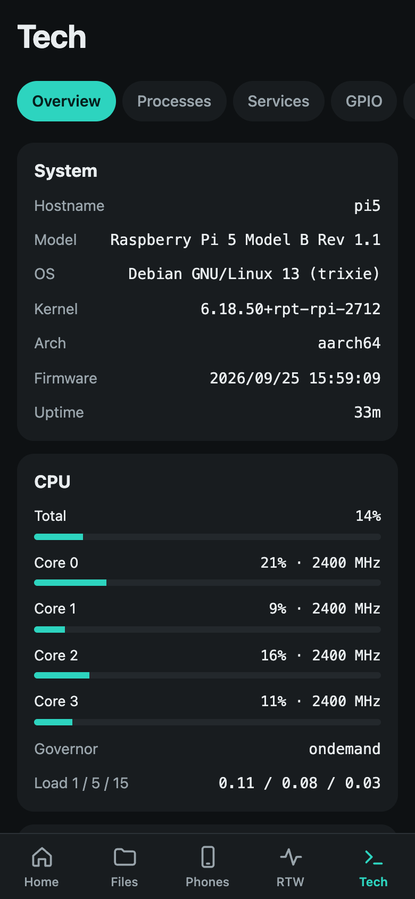
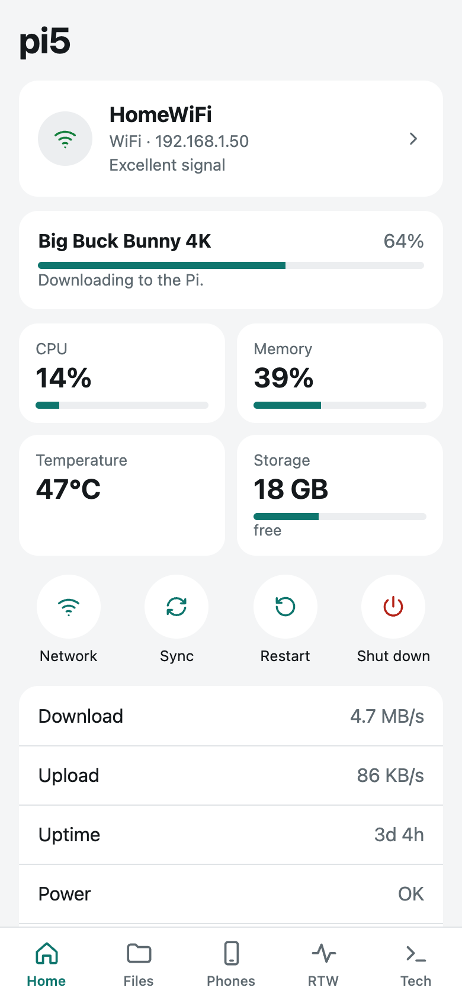
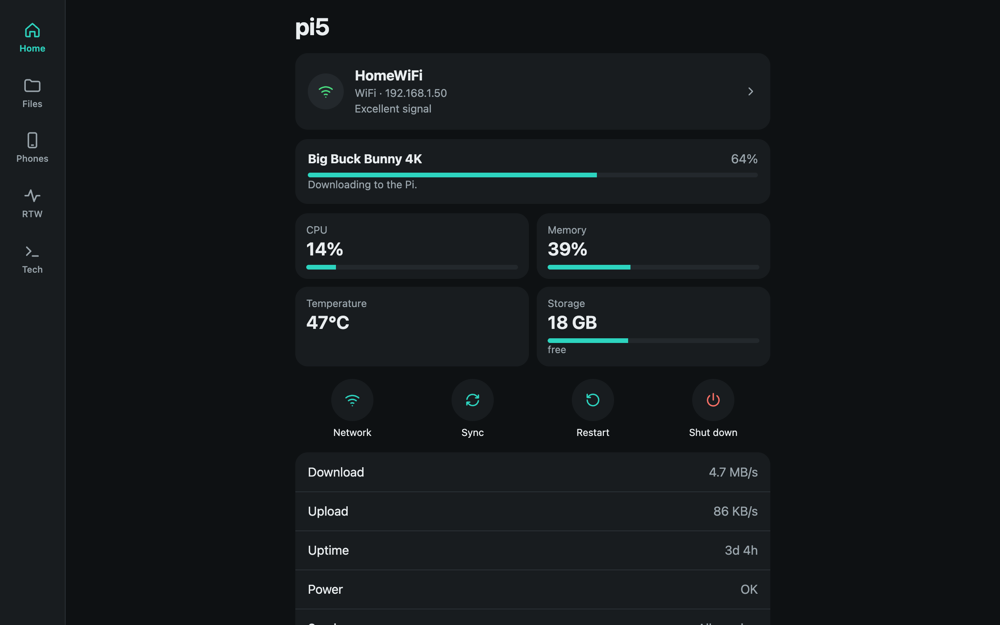

<p align="center">
  
</p>

<h1 align="center">pi5.local</h1>

<p align="center">
  A phone-style web dashboard that turns a Raspberry Pi 5 into your own small home server.
</p>

<p align="center">
  <a href="https://github.com/eslam-mahmoud/pi5.local/actions/workflows/ci.yml"></a>
  <a href="LICENSE"></a>
  
  
</p>

<p align="center">
  
</p>

Open `http://pi5.local` from any device on the same network to see the Pi's health, switch WiFi,
store files, back up phones and download video or audio. It keeps working with no internet,
because the Pi falls back to its own hotspot.

The backend is one small Python service. The frontend is plain HTML, CSS and JavaScript modules
in `dashboard/static`, with no libraries and no build step. It can be added to a phone's home
screen, and wide screens get a side rail instead of the bottom tabs.

## What it does

- **Home:** live stats, switch or join WiFi, start the hotspot, restart or shut down the Pi.
- **Files:** upload files or whole folders, download and organize preset files.
- **Downloads:** video and audio from [yt-dlp](https://github.com/yt-dlp/yt-dlp), sorted into folders.
- **Phones:** one-way backup with [Syncthing](https://syncthing.net), each phone in its own folder.
- **Addons:** install and run other apps beside the dashboard, starting with the
  [RTW](https://github.com/eslam-mahmoud/reinvent-the-wheel) offline library.
- **Tech:** read-only system detail for technical users.

## Screenshots

| Home | Network | Files |
| --- | --- | --- |
|  |  |  |

| Downloads | Phones | Addons |
| --- | --- | --- |
|  |  |  |

<details>
<summary>Tech tab, desktop and light theme</summary>







</details>

Screenshots use demo data. The theme follows your device's light or dark setting.

## Requirements

- Raspberry Pi 5 with 64-bit Raspberry Pi OS Lite (tested on Debian 13 trixie, 1 GB RAM)
- NetworkManager managing `wlan0`
- SSH key access from your computer to a user with passwordless `sudo`
- Internet on the Pi while installing

## Install

Create the hotspot once on the Pi. The fallback looks for a profile named `Hotspot`:

```bash
sudo nmcli connection add type wifi ifname wlan0 con-name Hotspot autoconnect no ssid pi5-ap mode ap ipv4.method shared 802-11-wireless.band bg wifi-sec.key-mgmt wpa-psk wifi-sec.psk 'choose-a-password'
```

Then, from your computer, say which user to connect as and deploy:

```bash
echo 'PI=pi@pi5.local' > deploy.env
```

```bash
./deploy.sh
```

This copies the project to the Pi and runs `system/install.sh`, which is safe to repeat. It keeps
the password, the paired phones and all stored files. `deploy.env` stays out of git.

To update code while the Pi has no internet, join its hotspot first. The installer's `apt` step
needs internet, so copy `dashboard/` to `/opt/pi5-dashboard` and restart `pi5-dashboard` instead.

## Addresses

| Network | Address |
| --- | --- |
| WiFi | `http://pi5.local`, or the address shown on the Home page |
| `pi5-ap` hotspot | `http://pi5.local` or `http://10.42.0.1` |

The dashboard listens on all interfaces, so it needs no change when the network switches.

If a Mac browser shows `ERR_ADDRESS_UNREACHABLE` or "Unable to connect", allow it under
System Settings → Privacy & Security → Local Network, then relaunch the browser.

## Project layout

| Path | Contents |
| --- | --- |
| `dashboard/` | Python service, one module per area |
| `dashboard/static/` | Web app |
| `addons/` | The registry of known addons, and one recipe for each that's ready |
| `system/` | Installer, systemd units, polkit rule, addon helper and the WiFi fallback |
| `docs/` | Addon guide and screenshots |
| `deploy.sh` | Copies the project to the Pi and installs it |

## Layout on the Pi

| Path | Contents |
| --- | --- |
| `/opt/pi5-dashboard` | App code, replaced on each deploy |
| `/srv/pi5/presets` | Preset files. Upload in the dashboard, or copy here as shown under [Files](#files) |
| `/srv/pi5/downloads` | Videos and audio from the Downloads screen |
| `/srv/pi5/phones/<phone>/<folder>` | Synced phone files |
| `/srv/pi5/phones/<phone>/<folder>/.stversions` | Older copies of files a phone edited or deleted |
| `/var/lib/pi5` | Password hash, phone list and Syncthing config |
| `/opt/pi5-addons` | Addon recipes, replaced on each deploy |
| `/var/lib/pi5-addons/<addon>` | An addon's code and config, deleted when it's removed |
| `/srv/pi5/addons/<addon>` | An addon's files, kept when it's removed |

Services: `pi5-dashboard` on port 80 and `pi5-syncthing` on port 22000. Both run as the
unprivileged `pi5` user. The Syncthing admin page is only reachable from the Pi itself.

## Network

`wifi-fallback.timer` checks the connection every 2 minutes and starts the hotspot when `wlan0`
has no network.

- Choosing the hotspot pauses `wifi-fallback.timer`, or it would rejoin WiFi by itself. It
  starts again when you connect to WiFi or reboot.
- If a network can't be joined, the Pi goes back to the previous one, and a new network
  isn't saved.
- The radio can't scan while it's a hotspot. Scanning from the hotspot turns it off for
  about 20 seconds, so connected devices drop and rejoin, then the list appears under Network.
- Anything that would stop a running upload asks first.
- Shut down turns the Pi off. Press its power button or replug the power to start it.

## Files

- Tap a photo, PDF, video, audio or text file to view it full screen, with **Download**,
  **New tab** and **Delete** below it. The arrows, or the arrow keys, move through the other
  files in the folder. This works in Files, Downloads and phone backups.
- Other files, such as Word or Excel documents, open a sheet with **Download**. HTML and SVG
  files are always downloaded, because they could run code inside the dashboard.
- Upload files or a whole folder from **+**, or drag them onto the list. Subfolders are kept,
  and hidden files such as `.DS_Store` are skipped.
- Nothing is overwritten. A file whose name is taken is saved beside it, as `name (1).ext`.
- Uploading a folder again skips files already there at the same size, so an interrupted
  upload can be picked up where it stopped.
- Folder uploads work in desktop browsers. A phone may only let you pick files.

For a very large folder, copy it from your computer over SSH instead. It resumes if you run it
again after an interruption:

```bash
rsync -rt --progress --exclude='.*' --rsync-path='sudo -u pi5 rsync' "My Folder" pi@pi5.local:/srv/pi5/presets/
```

`--rsync-path` saves the files as the dashboard's own user. Without it, or with `scp` or a plain
`rsync -a`, the dashboard can show the files but can't change or delete them.

## Downloads

Files → Downloads fetches one item at a time and sorts everything into folders:

```text
Videos/<channel>/<title> [<id>].mp4
Videos/<channel>/<playlist>/001 - <title> [<id>].mp4
Audio/<channel>/<title> [<id>].mp3
```

A folder name typed with a download replaces `<channel>`. The ID in each filename keeps two
videos with the same title apart.

- yt-dlp is the official release in `/var/lib/pi5/bin`, because Debian's version is too old
  for YouTube. Use **Update** on the Downloads screen if a site stops working.
- It uses `ffmpeg` for merging and converting, and Node.js for YouTube.
- A download stops if the Pi has less than 1 GB free, and new ones are refused until there's room.
- A running download survives a page reload, but not a dashboard or Pi restart.
- Only download content you have the right to save.

## Addons

An addon is a separate project that the dashboard installs and runs beside itself, as its own
service with its own user and port. The Addons tab installs, opens, starts, stops, updates and
removes each one. Installing and updating need internet. Installed addons keep working on the
hotspot.

Known addons are listed in the [registry](addons/registry.json). To add one, see the
[addon guide](docs/addons.md). The [master prompt](docs/addon-master-prompt.md) lets a coding
assistant do the packaging.

### RTW

[RTW](https://github.com/eslam-mahmoud/reinvent-the-wheel) is an offline library with Wikipedia,
books, notes, maps and apps. It runs unchanged from its own repository, at
`http://pi5.local:8080`, and uses about 130 MB of RAM with the full Arabic Wikipedia loaded.

- Add content from its admin page. On the Addons tab, open RTW's menu for **Show admin password**.
- Library files are in `/srv/pi5/addons/rtw`.
- Press **Restart** if the card says **Not responding**. RTW's scripts run in the background, so
  a crash isn't restarted by itself. It does start again after a reboot.
- **Update** installs the latest version of RTW's `main` branch.

#### Add Wikipedia and maps

Run these on the Pi over SSH. The download runs on the Pi and carries on if SSH disconnects, but
it needs internet and stops if the Pi loses power.

Arabic Wikipedia, text only, about 8.4 GB. Add `--setenv=ZIM_PATTERN=wikipedia_ar_all_mini` for
the 3 GB version:

```bash
sudo systemd-run --collect --unit=rtw-wikipedia --uid=pi5-addon-rtw --setenv=HOME=/var/lib/pi5-addons/rtw /var/lib/pi5-addons/rtw/app/rtw fetch wikipedia
```

Saudi Arabia and Egypt maps, about 1.2 GB. Add `--setenv=MAXZOOM=14` for less street detail and
a smaller file:

```bash
sudo systemd-run --collect --unit=rtw-maps --uid=pi5-addon-rtw --setenv=HOME=/var/lib/pi5-addons/rtw /var/lib/pi5-addons/rtw/app/rtw fetch maps
```

Follow either one, then press Ctrl+C to stop watching. The download keeps going:

```bash
journalctl -fu rtw-wikipedia
```

- **Wikipedia:** when it finishes, open RTW's menu on the Addons tab and tap **Restart**. Don't use
  `rtw restart`, which RTW suggests, because that starts it outside its service.
- **Maps:** they appear without a restart.
- **If it's interrupted:** run the same command again. Wikipedia resumes, and maps start over.
- **From a computer:** you can also upload a `.zim` or `.pmtiles` file on RTW's admin page, and
  an uploaded `.zim` starts serving by itself.

## Tech tab

- **Overview:** system, per-core CPU, clocks, voltages, throttle flags, temperatures, fan,
  memory, disks and I/O, network interfaces.
- **Processes:** top 15 by CPU. It shows names only, because command lines can hold secrets.
- **Services:** every systemd service, grouped and searchable.
- **GPIO:** the 40-pin header from `pinctrl -p`. Pins can't be changed from the dashboard.
- **Devices:** USB devices and Docker containers.
- **Logs:** recent journal entries since the last boot.

The dashboard joins the `video`, `gpio` and `systemd-journal` groups to read these.

## Phone sync rules

- A phone syncs nothing until it is approved in the dashboard.
- Each phone gets its own directory, even if two phones share a name.
- A folder ID already used by another phone is refused, because Syncthing would merge them.
- The Pi is receive-only and never changes anything on a phone.
- Sync works on the home WiFi or the hotspot only. Relays and internet discovery are off.
- `.stversions` is never cleaned automatically, so it keeps growing. Syncthing stops writing
  when the card has less than 5% free.

## Password and security

The first install generates a password and saves it in the deploying user's home on the Pi:

```bash
ssh pi@pi5.local cat pi5-dashboard-password.txt
```

To change it:

```bash
ssh -t pi@pi5.local 'sudo -u pi5 python3 /opt/pi5-dashboard/app.py --set-password && sudo systemctl restart pi5-dashboard && rm -f ~/pi5-dashboard-password.txt'
```

The dashboard is meant for a trusted local network. It uses plain HTTP, so don't expose it to
the internet. What the `pi5` user may do is limited by `system/50-pi5-dashboard.rules`.

## Adding a section

Add `dashboard/<name>.py` with a `setup(app)` function like the other modules and call it from
`create_app()` in `app.py`. Add `static/js/<name>.js` exporting `show()`, which returns the
screen's nodes, and register it in `static/js/main.js`.

## Project status

pi5.local is new and has been developed and tested on one Raspberry Pi 5 with 1 GB of RAM. See
the [changelog](CHANGELOG.md) for what's included.

## Contributing

Bug reports and pull requests are welcome. See [CONTRIBUTING.md](CONTRIBUTING.md) to run it
locally, and [SECURITY.md](SECURITY.md) to report a security problem.

## License

[MIT](LICENSE)
